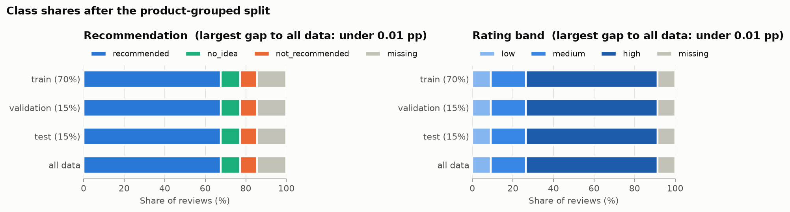

# Digikala Review Analysis

Classifying Persian product reviews from [Digikala](https://www.digikala.com) using only the review text:

- **Recommendation:** does the reviewer recommend the product (`recommended`, `not_recommended`, `no_idea`)?
- **Rating band:** is the review's rating `low`, `medium` or `high`?

The plan is to compare a TF-IDF + Logistic Regression baseline with a fine-tuned Persian Transformer, and to test whether pseudo-labeling unlabeled reviews improves the recommendation classifier.

> Work in progress.

## Setup

Requires Python 3.13. With [uv](https://docs.astral.sh/uv/):

```bash
git clone https://github.com/alidarviish/digikala-review-analysis.git
cd digikala-review-analysis
uv sync
```

Or with pip:

```bash
pip install -r requirements.txt
pip install -e .
```

## Data

The dataset is not included in this repository. Download `digikala.rar` from
[RadeAI/Digikala_comments_products](https://huggingface.co/datasets/RadeAI/Digikala_comments_products/tree/main)
on Hugging Face (MIT license) and extract it into `data/raw/`:

```
data/raw/
├── digikala-comments.csv
└── digikala-products.csv
```

Then build the cleaned table:

```bash
uv run python scripts/build_parquet.py     # CSV -> Parquet, with an independent row count
uv run python scripts/run_quality_gate.py  # schema and quality checks -> reports/quality_gate.json
uv run python scripts/build_clean.py       # cleaning rules -> data/interim/comments_clean.parquet
```

Then split the data and write the standard files:

```bash
uv run python scripts/check_normalization.py    # what normalization changes -> reports/normalization_report.json
uv run python scripts/build_splits.py           # product-grouped split -> reports/split_report.json (about 15 min)
uv run python scripts/plot_split_balance.py     # reports/figures/split_balance.png
uv run python scripts/build_standard_files.py   # masking and the standard CSV files -> data/splits/
uv run python scripts/verify_standard_files.py  # checks every file against the source data
```

Read the CSV files with `digikala_reviews.standard_files.read_split_file`. Plain `pd.read_csv` turns reviews
such as `NA` or `null` into missing values.

## What the data looks like

The full audit is in [`notebooks/01_descriptive_analysis.ipynb`](notebooks/01_descriptive_analysis.ipynb).
A few findings shaped the rest of the project:

**A rating of 0 means "no rating recorded", not "very bad".** 80% of zero-rated reviews are `recommended`, the
same as 4 and 5 star reviews, and zeros only show up in large numbers between late 1397 and mid-1401 (Jalali
calendar). Counting them as `low` would have made almost half of that class wrong, so they get no rating band.


**Both targets are imbalanced.** `recommended` is 67.6% of reviews and `low` only 9.1%, so Macro F1 is the main
metric.


**Reviews are concentrated on few products.** The top 10% of products hold 67% of the reviews, so the data is split
by product: a product never appears in more than one split.

**Reviews are short and often repeated.** The median review has 6 words, and 37% of reviews share their exact text
with another one (`عالی` alone appears 134,623 times). Identical texts get identical predictions, so a text-only
model can reach at most 97.5% accuracy on recommendation and 94.6% on rating band.

**The words people use are clear signals.** Negation and complaint words separate the classes well, while
positive reviews are full of stretched spellings like `عالیییی`, which a light normalization step merges.


**Limits.** The reviews cover six product groups (beauty, books, clothing, toys, travel and local goods). There are
no electronics or appliances, so results should not be assumed to carry over to them.

## Split and semi-supervised setup

Products are split 70/15/15 into train, validation and test with `StratifiedGroupKFold`, balanced on the
combination of both targets. No product is in more than one part, and the class shares of both targets are the
same in every part to within 0.01 percentage points. Two other seeds give the same balance, so it does not depend
on a lucky seed.



For the semi-supervised experiment, 20% of the labeled training rows of each recommendation class (736,134 rows)
have their labels hidden, using the hash rule shared by everyone working on this dataset. Validation and test are
never masked. The full record of seeds, rules, counts and file hashes is in
[`reports/split_manifest.json`](reports/split_manifest.json).

| File | Rows | Contents |
|---|---:|---|
| `train_supervised.csv` | 3,552,498 | train rows with at least one label, masked rows removed |
| `train_pseudo_unlabeled.csv` | 736,134 | masked train rows, `id` and `body` only |
| `natural_unlabeled.csv` | 625,700 | train rows that never had a recommendation label |
| `validation.csv` | 922,795 | every validation row |
| `test.csv` | 922,795 | every test row |

About 37% of validation and test reviews have exactly the same normalized text as some training review, mostly
short ones like `عالی`. That is not leakage, since the products differ, but it makes part of the test easy, so
results are reported both for all reviews and for texts never seen in training.
