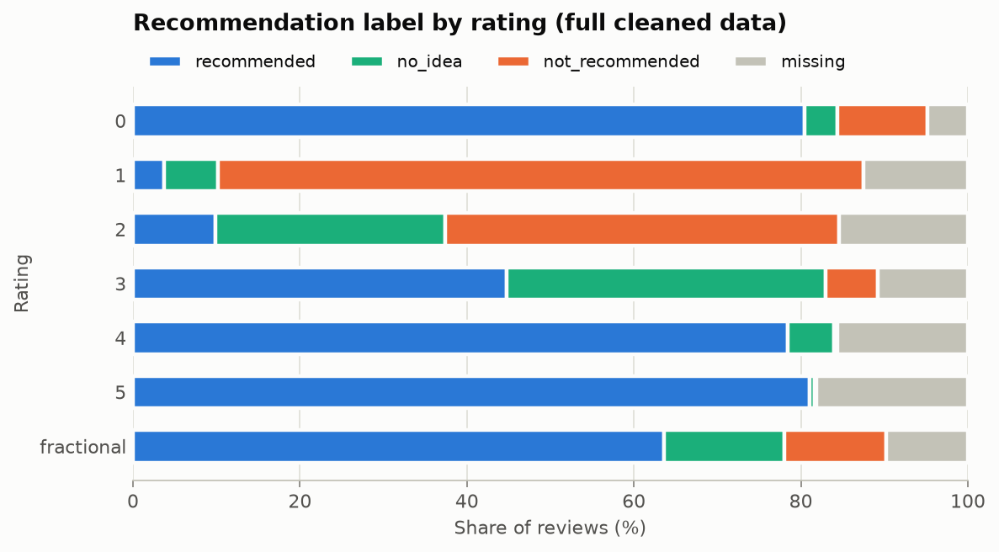
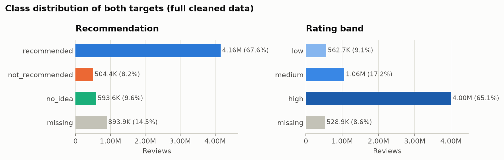
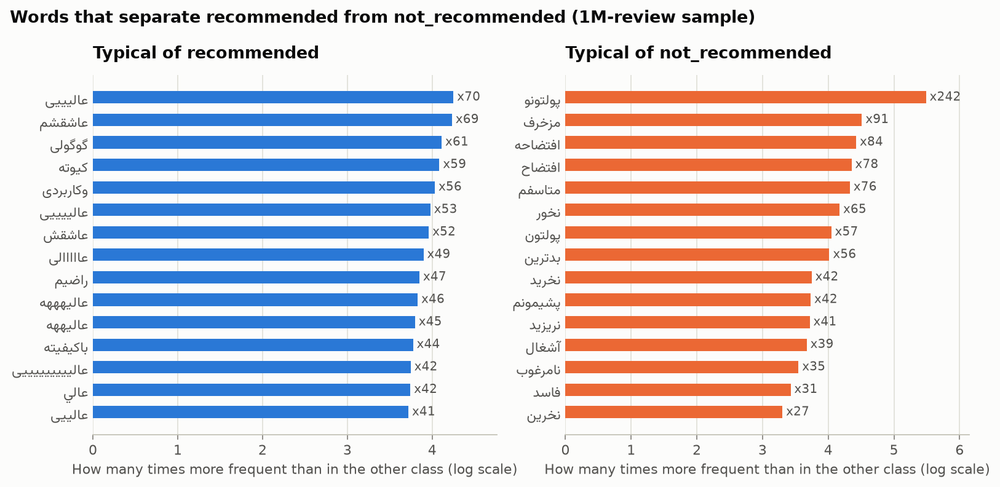
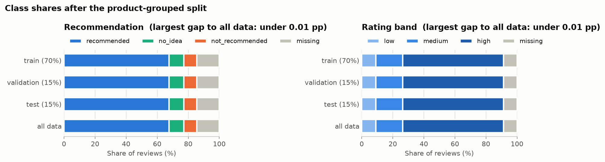
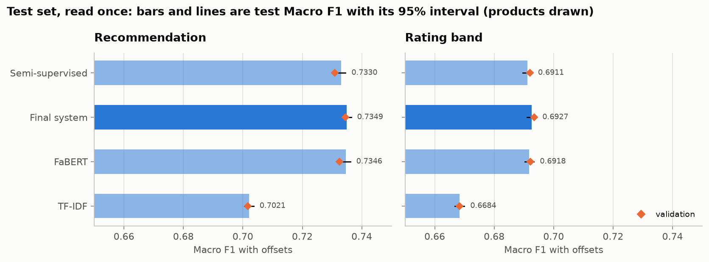

# Digikala Review Analysis

Classifying Persian product reviews from [Digikala](https://www.digikala.com) using only the review text:

- **Recommendation:** does the reviewer recommend the product (`recommended`, `not_recommended`, `no_idea`)?
- **Rating band:** is the review's rating `low`, `medium` or `high`?

A TF-IDF + Logistic Regression baseline is compared with a fine-tuned Persian Transformer (FaBERT), and pseudo-labeling
of unlabeled reviews is tested on the recommendation classifier.

**Result.** On the held-out test set, read once at the end, the final system (FaBERT and TF-IDF combined) reaches
Macro F1 **0.735** on recommendation and **0.693** on the rating band (accuracy 87.3% and 79.3%), 3.2 and 2.3 points
above TF-IDF. Pseudo-labeling with the project's protocol did **not** help (−0.16 point). The full account is in
[`reports/final_report.md`](reports/final_report.md).

## Setup

Requires Python 3.13. With [uv](https://docs.astral.sh/uv/):

```bash
git clone https://github.com/alidarviish/digikala-review-analysis.git
cd digikala-review-analysis
uv sync
```

Or with pip:

```bash
pip install -r requirements.txt
pip install -e .
```

The optional groups: `transformer` runs FaBERT on your own machine (CPU only), `api` the prediction service, `dev`
the notebooks and tests. Everything at once:

```bash
uv sync --all-groups
uv run pytest
```

## Offline prediction

The saved models answer for a review text, with no internet once FaBERT's tokenizer and
configuration are saved (the trained weights come from `artifacts/`, see the pipeline):

```bash
uv run python scripts/save_fabert_files.py      # once
uv run python scripts/predict.py "کیفیتش خوبه ولی گرونه"
uv run python scripts/predict.py --json "کیفیتش خوبه ولی گرونه"
uv run python scripts/predict.py --demo         # examples, written to reports/predict_demo.md
```

For each head it prints the label and probabilities of TF-IDF, FaBERT and the final system
(both combined; `uncertain` when its confidence is under the threshold of
`reports/uncertain.json`), the words that pushed TF-IDF most, the token count and whether the
text was cut at 128 tokens, the latency of each model, and the exact rate predicted by the rate model (an
extension; it changes no label).

## Prediction service

The same predictor behind an HTTP API (FastAPI). The trained models must be in `artifacts/` (see the pipeline):

```bash
uv run uvicorn app.main:app --port 8000      # then http://localhost:8000/docs
docker compose up --build                     # or in a CPU-only container; artifacts/ is mounted read-only
```

Without `compose.yaml`, mount the models yourself (the image does not contain them):

```bash
docker build -t digikala-review-api .
docker run --rm -p 8000:8000 -v "$PWD/artifacts:/app/artifacts:ro" digikala-review-api
```

| Endpoint | What it answers |
|---|---|
| `GET /health`, `GET /ready` | the service is alive; the models are loaded (503 until they are) |
| `POST /normalize`, `POST /tokenize` | the normalized text; FaBERT's tokens, token count and truncation |
| `POST /predict` | `{"text": "...", "model": "final"}` (or `tfidf`, `transformer`): both heads with probabilities, and `predicted_rate` |
| `POST /predict/tfidf`, `POST /predict/transformer` | the same for one model |
| `POST /predict/compare` | the three models side by side |

An empty text or one longer than 5,000 characters gets 422, an unknown model 400, a request before the models are
loaded 503. Review texts are never logged. In the container the service is ready 43 seconds after start and
answers `/health` and `/ready` from inside too; the image is 2.45 GB without the models
([`reports/docker_check.json`](reports/docker_check.json)).

## Data

The dataset is not included in this repository. Download `digikala.rar` from
[RadeAI/Digikala_comments_products](https://huggingface.co/datasets/RadeAI/Digikala_comments_products/tree/main)
on Hugging Face (MIT license) and extract it into `data/raw/`:

```
data/raw/
├── digikala-comments.csv
└── digikala-products.csv
```

Then build the cleaned table:

```bash
uv run python scripts/build_parquet.py     # CSV -> Parquet, with an independent row count
uv run python scripts/run_quality_gate.py  # schema and quality checks -> reports/quality_gate.json
uv run python scripts/build_clean.py       # cleaning rules -> data/interim/comments_clean.parquet
```

Then split the data and write the standard files:

```bash
uv run python scripts/check_normalization.py    # what normalization changes -> reports/normalization_report.json
uv run python scripts/build_splits.py           # product-grouped split -> reports/split_report.json (about 15 min)
uv run python scripts/plot_split_balance.py     # reports/figures/split_balance.png
uv run python scripts/build_standard_files.py   # masking and the standard CSV files -> data/splits/
uv run python scripts/verify_standard_files.py  # checks every file against the source data
```

Read the CSV files with `digikala_reviews.standard_files.read_split_file`. Plain `pd.read_csv` turns reviews
such as `NA` or `null` into missing values.

## What the data looks like

The full audit is in [`notebooks/01_descriptive_analysis.ipynb`](notebooks/01_descriptive_analysis.ipynb).
A few findings shaped the rest of the project:

**A rating of 0 means "no rating recorded", not "very bad".** 80% of zero-rated reviews are `recommended`, the
same as 4 and 5 star reviews, and zeros only show up in large numbers between late 1397 and mid-1401 (Jalali
calendar). Counting them as `low` would have made almost half of that class wrong, so they get no rating band.



**Both targets are imbalanced.** `recommended` is 67.6% of reviews and `low` only 9.1%, so Macro F1 is the main
metric.



**Reviews are concentrated on few products.** The top 10% of products hold 67% of the reviews, so the data is split
by product: a product never appears in more than one split.

**Reviews are short and often repeated.** The median review has 6 words, and 37% of reviews share their exact text
with another one (`عالی` alone appears 134,623 times). Identical texts get identical predictions, so a text-only
model can reach at most 97.5% accuracy on recommendation and 94.6% on rating band.

**The words people use are clear signals.** Negation and complaint words separate the classes well, while
positive reviews are full of stretched spellings like `عالیییی`, which a light normalization step merges.



**Limits.** The reviews cover six product groups (beauty, books, clothing, toys, travel and local goods). There are
no electronics or appliances, so results should not be assumed to carry over to them.

## Split and semi-supervised setup

Products are split 70/15/15 into train, validation and test with `StratifiedGroupKFold`, balanced on the
combination of both targets. No product is in more than one part, and the class shares of both targets are the
same in every part to within 0.01 percentage points. Two other seeds give the same balance, so it does not depend
on a lucky seed.



For the semi-supervised experiment, 20% of the labeled training rows of each recommendation class (736,134 rows)
have their labels hidden, using the hash rule shared by everyone working on this dataset. Validation and test are
never masked. The full record of seeds, rules, counts and file hashes is in
[`reports/split_manifest.json`](reports/split_manifest.json).

| File | Rows | Contents |
|---|---:|---|
| `train_supervised.csv` | 3,552,498 | train rows with at least one label, masked rows removed |
| `train_pseudo_unlabeled.csv` | 736,134 | masked train rows, `id` and `body` only |
| `natural_unlabeled.csv` | 625,700 | train rows that never had a recommendation label |
| `validation.csv` | 922,795 | every validation row |
| `test.csv` | 922,795 | every test row |

About 37% of validation and test reviews have exactly the same normalized text as some training review, mostly
short ones like `عالی`. That is not leakage, since the products differ, but it makes part of the test easy, so
results are reported both for all reviews and for texts never seen in training.

## Results on the test set

The test set was read once, at the end, for four models fixed before
([`reports/final_evaluation_plan.md`](reports/final_evaluation_plan.md)). Macro F1 with offsets and its 95% interval,
drawing whole products ([`reports/final_evaluation.json`](reports/final_evaluation.json)):

| Model | Recommendation: accuracy | Macro F1 | Rating band: accuracy | Macro F1 | Ordinal error |
|---|---:|---:|---:|---:|---:|
| TF-IDF + Logistic Regression | 0.849 | 0.7021 [0.7005, 0.7036] | 0.777 | 0.6684 [0.6668, 0.6700] | 0.241 |
| FaBERT, fine-tuned | 0.873 | 0.7346 [0.7331, 0.7361] | 0.794 | 0.6918 [0.6903, 0.6934] | 0.218 |
| **Final system: FaBERT + TF-IDF** | **0.873** | **0.7349** [0.7334, 0.7364] | **0.793** | **0.6927** [0.6911, 0.6942] | **0.219** |
| Semi-supervised student | 0.876 | 0.7330 [0.7314, 0.7345] | 0.792 | 0.6911 [0.6896, 0.6927] | 0.220 |



- **Validation was a reliable guide:** every model is within a quarter point of its validation score.
- **The final system can say "uncertain"** on its least confident 10% of reviews; on the others its accuracy is
  91.9% and 84.0%.
- **Pseudo-labeling did not help.** 72.4% of the hidden reviews got a pseudo-label, 96.9% of them right, but 94.9%
  were `recommended`: the student gains accuracy and loses the hard `no_idea` class
  ([`notebooks/04_semi_supervised.ipynb`](notebooks/04_semi_supervised.ipynb)).
- **The hard classes are `no_idea` and `medium`** (F1 near 0.5 for every model); a third of the errors read in the
  error analysis are label problems rather than model errors.

**Extensions** (all the optional ones, reported apart; [`reports/final_report.md`](reports/final_report.md),
section 7): FaBERT also predicts the exact rate (R² 0.58 and MAE 0.55 on test, against 0.52 and 0.61 for a TF-IDF
ridge regression); with the encoder frozen it falls 7.4 points, below TF-IDF; other pseudo-label thresholds,
pseudo-labels for the rating band and the naturally unlabeled reviews do not help either.

## How the choices were made (validation set)

Every choice was made on validation, with the expected outcome written down before running. Every number below
comes from a file in `reports/`, and all of them are collected with their commits in
[`reports/results_summary.md`](reports/results_summary.md).

| Model | Recommendation Macro F1 | Balanced accuracy | Rating band Macro F1 | Balanced accuracy | Ordinal error |
|---|---:|---:|---:|---:|---:|
| TF-IDF + Logistic Regression, with offsets | 0.7017 | 0.7110 | 0.6683 | 0.6596 | 0.241 |
| FaBERT, fine-tuned, with offsets | 0.7324 | 0.7320 | 0.6922 | 0.6813 | 0.218 |
| Final system: FaBERT + TF-IDF | 0.7344 | 0.7376 | 0.6935 | 0.6836 | 0.217 |

Offsets are one number per class added to the model's log probabilities before the top class is chosen, tuned
for Macro F1 on one half of validation and scored on the other. Balanced accuracy is the mean recall over the
classes, so it is not raised by the large `recommended` and `high` classes. The ordinal error is how many bands a
prediction is off on average; only about 1.2% of FaBERT's rating bands are two bands off. Every required score
for every model is in [`reports/required_metrics.json`](reports/required_metrics.json).

- **The numbers are stable.** FaBERT trained again with two other seeds moves by about 0.1 point (0.7312 to
  0.7324, 0.6922 to 0.6929), far less than the differences the decisions rest on
  ([`reports/full_seeds_plan.md`](reports/full_seeds_plan.md)).
- **The hard part is the ambiguous classes.** FaBERT reaches an F1 of 0.94 on `recommended` and 0.89 on `high`,
  but 0.51 on `no_idea` and 0.48 on `medium`.
- **Much of that is in the labels, not the model.** Three models that read the text in different ways (FaBERT,
  TF-IDF and a BiLSTM trained from scratch) get 9% and 16% of reviews all wrong, and on 90% and 94% of those they
  give the same wrong label. These are mostly reviews rated exactly 3 (or 4 for `high`, 2 for `low`), or whose
  two buyer labels point different ways: 81% of the reviews rated 3 that FaBERT reads as `high` were recommended
  by the buyer ([`reports/reading_models_plan.md`](reports/reading_models_plan.md),
  [`reports/label_analyses.md`](reports/label_analyses.md)). A large language model that never saw the labels
  sides with the three models on these rating-band mistakes ([`reports/independent_reader_plan.md`](reports/independent_reader_plan.md)).
- **On repeated texts the models are at the limit.** For texts seen at least 5 times (a quarter of the reviews),
  no text-only model can be more accurate than giving each text its most frequent label; FaBERT reaches 99.6% and
  98.6% of that ceiling ([`reports/text_ceiling_plan.md`](reports/text_ceiling_plan.md)).
- **Changing the training did not help.** Merging repeated texts, focal loss, class weights, leaving out the
  hardest labels, two curricula and other learning rates all tied with or lost to the usual training
  ([`reports/hard_examples_plan.md`](reports/hard_examples_plan.md),
  [`reports/difficulty_plan.md`](reports/difficulty_plan.md)). Pretraining FaBERT further on the review texts
  gives the best single model (0.7337 and 0.6931), but combined with TF-IDF it adds nothing on recommendation, so
  the final system stays as it is ([`reports/domain_adaptation_plan.md`](reports/domain_adaptation_plan.md)).
- **A larger model does not help either.** TookaBERT-Large, three times the size, ties FaBERT on recommendation
  and is 0.16 point higher on rating band ([`reports/large_final_plan.md`](reports/large_final_plan.md)).
- **Combining FaBERT with TF-IDF helps a little.** +0.2 point on recommendation and +0.1 on rating band, with
  intervals above zero that draw whole products, and with each of the three FaBERT seeds
  ([`reports/ensemble_plan.md`](reports/ensemble_plan.md), [`reports/decision_recheck_plan.md`](reports/decision_recheck_plan.md)).
- **The probabilities are close to honest.** One temperature per head (1.12 and 1.11) brings the calibration
  error below 0.01 without changing the scores ([`reports/calibration_plan.md`](reports/calibration_plan.md)).

## Notebooks and reports

| | What |
|---|---|
| [`01_descriptive_analysis`](notebooks/01_descriptive_analysis.ipynb) | the data audit |
| [`02_baselines`](notebooks/02_baselines.ipynb) | TF-IDF: tuning, experiments, the kept model |
| [`03_transfer_learning_finetuning`](notebooks/03_transfer_learning_finetuning.ipynb) | the Transformer: model choice, training, the final system |
| [`04_semi_supervised`](notebooks/04_semi_supervised.ipynb) | pseudo-labeling as the project defines it |
| [`reports/final_report.md`](reports/final_report.md) | the final report: results, extensions, error analysis, limitations |
| [`reports/results_summary.md`](reports/results_summary.md) | every result with the commit it was made with |
| [`reports/release_report.json`](reports/release_report.json) | the delivered files with their hashes |

## Reproduce

Every step of the project is one script, in the order set in
[`src/digikala_reviews/pipeline.py`](src/digikala_reviews/pipeline.py). The notebook
[`notebooks/run_all.py`](notebooks/run_all.py) runs them: `uvx marimo edit notebooks/run_all.py` on your own machine,
or on molab for the GPU steps (fill in the commit, click *Set up*, then download the outputs and bring them in with
`uv run python scripts/import_colab_outputs.py <folder>`). A step is skipped when its outputs exist.
`scripts/verify_standard_files.py` checks the split files against
[`reports/split_manifest.json`](reports/split_manifest.json).

## Licences

The code is in this repository. The dataset is MIT-licensed; the split files and the TF-IDF model are assets of the
GitHub release `v1.0`. FaBERT ([`sbunlp/fabert`](https://huggingface.co/sbunlp/fabert)) declares no licence, so its
fine-tuned weights are not published; they are given privately with the submission.
