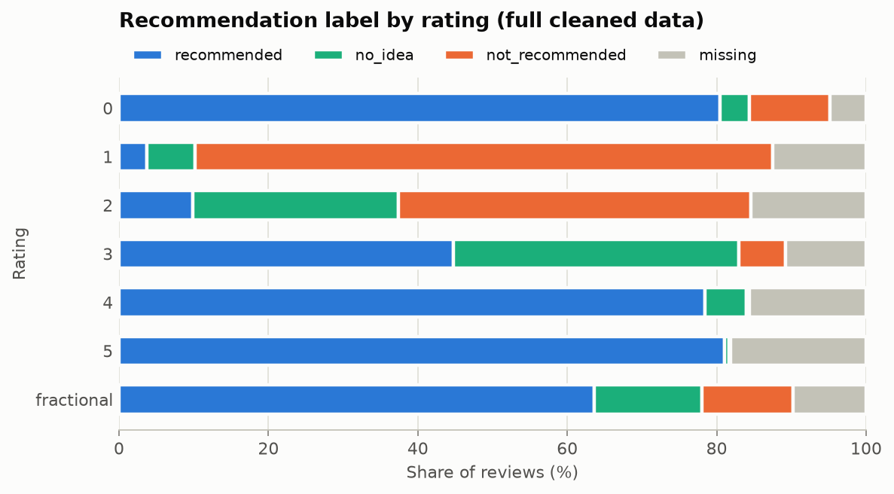
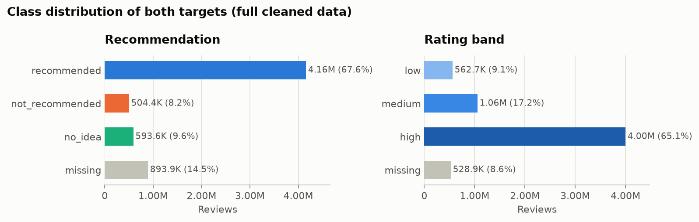
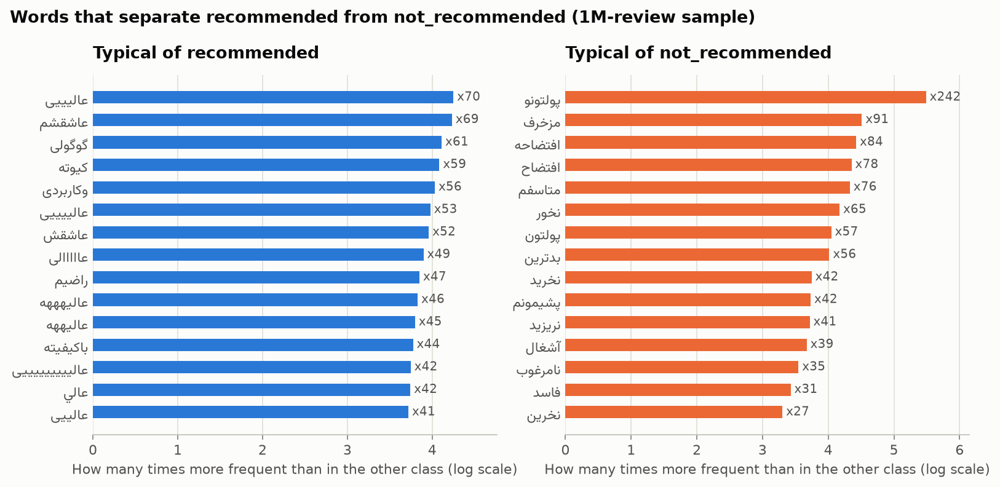

# Digikala Review Analysis

Classifying Persian product reviews from [Digikala](https://www.digikala.com) using only the review text:

- **Recommendation:** does the reviewer recommend the product (`recommended`, `not_recommended`, `no_idea`)?
- **Rating band:** is the review's rating `low`, `medium` or `high`?

The plan is to compare a TF-IDF + Logistic Regression baseline with a fine-tuned Persian Transformer, and to test whether pseudo-labeling unlabeled reviews improves the recommendation classifier.

> Work in progress.

## Setup

Requires Python 3.13. With [uv](https://docs.astral.sh/uv/):

```bash
git clone https://github.com/alidarviish/digikala-review-analysis.git
cd digikala-review-analysis
uv sync
```

Or with pip:

```bash
pip install -r requirements.txt
pip install -e .
```

## Data

The dataset is not included in this repository. Download `digikala.rar` from
[RadeAI/Digikala_comments_products](https://huggingface.co/datasets/RadeAI/Digikala_comments_products/tree/main)
on Hugging Face (MIT license) and extract it into `data/raw/`:

```
data/raw/
├── digikala-comments.csv
└── digikala-products.csv
```

Then build the cleaned table:

```bash
uv run python scripts/build_parquet.py     # CSV -> Parquet, with an independent row count
uv run python scripts/run_quality_gate.py  # schema and quality checks -> reports/quality_gate.json
uv run python scripts/build_clean.py       # cleaning rules -> data/interim/comments_clean.parquet
```

## What the data looks like

The full audit is in [`notebooks/01_descriptive_analysis.ipynb`](notebooks/01_descriptive_analysis.ipynb).
A few findings shaped the rest of the project:

**A rating of 0 means "no rating recorded", not "very bad".** 80% of zero-rated reviews are `recommended`, the
same as 4 and 5 star reviews, and zeros only show up in large numbers between late 1397 and mid-1401 (Jalali
calendar). Counting them as `low` would have made almost half of that class wrong, so they get no rating band.



**Both targets are imbalanced.** `recommended` is 67.6% of reviews and `low` only 9.1%, so Macro F1 is the main
metric.



**Reviews are concentrated on few products.** The top 10% of products hold 67% of the reviews, so the data is split
by product: a product never appears in more than one split.

**Reviews are short and often repeated.** The median review has 6 words, and 37% of reviews share their exact text
with another one (`عالی` alone appears 134,623 times). Identical texts get identical predictions, so a text-only
model can reach at most 97.5% accuracy on recommendation and 94.6% on rating band.

**The words people use are clear signals.** Negation and complaint words separate the classes well, while
positive reviews are full of stretched spellings like `عالیییی`, which a light normalization step merges.



**Limits.** The reviews cover six product groups (beauty, books, clothing, toys, travel and local goods). There are
no electronics or appliances, so results should not be assumed to carry over to them.
