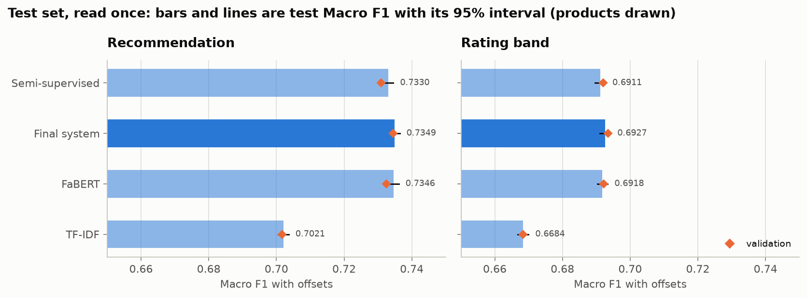
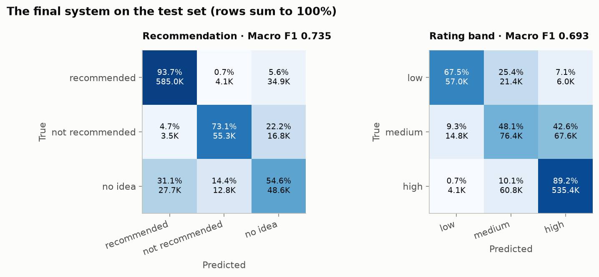
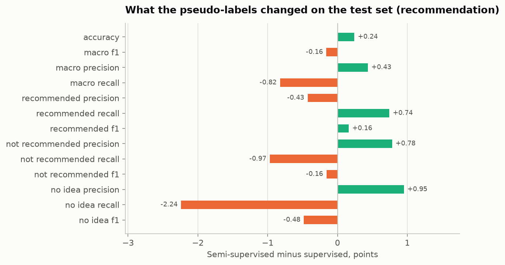
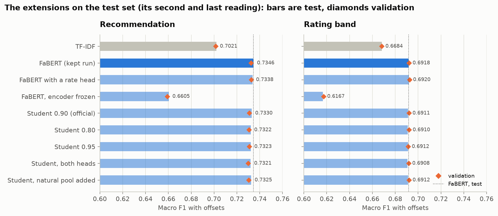
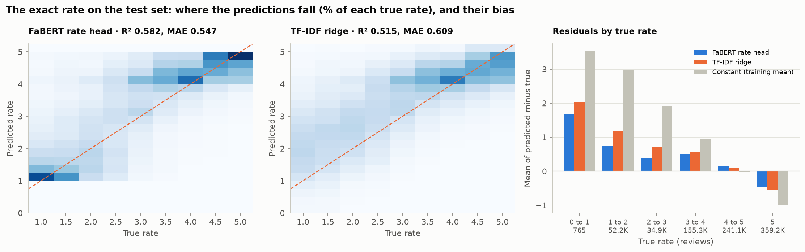

# Final report: recommendation and rating band from Persian Digikala reviews

> Can the text of a Persian product review predict both the user's recommendation status and ordered rating band,
> and can unlabeled reviews improve the classifier?

**Short answer.** Yes for the first part: from the review text alone, the final system reaches Macro F1 **0.735** for
the recommendation (three classes) and **0.693** for the rating band on the held-out test set, with accuracy 87.3% and
79.3%. The fine-tuned Transformer beats the TF-IDF baseline by 3.2 and 2.3 points. No for the second part: with the
project's pseudo-labeling protocol, the unlabeled reviews did not improve the classifier (−0.16 point on the test set).
The optional extensions (section 7) change neither answer: FaBERT also predicts the exact rate (R² 0.58, against 0.52
for TF-IDF), no variant of pseudo-labeling helps, and the system runs as an HTTP service in a CPU-only Docker container.

Every number in this report is read from a file in `reports/`; the main files are named in each section.
`reports/release_report.json` lists the delivered files with their hashes.

## 1. Data

- **Source:** the public Digikala comments and products dataset (RadeAI, MIT licence): 6,156,289 reviews and
  1,283,496 product rows, counted with a CSV parser (`reports/data_ingest.json`). Notebook 01 covers the whole audit.
- **Cleaning** (`reports/cleaning_report.json`): 6,151,970 reviews kept. Removed: 2,984 extra copies of a repeated id,
  845 reviews without a body, and 490 rows whose copies of one id disagree on text, rate or label (rule P7;
  `reports/p7_conflicts.json` shows that the right copy cannot be told).
- **A rating of 0 means "no rating recorded", not "very bad"** (notebook 01, section 4): 80% of the 528,914 zero-rated
  reviews are `recommended`, zeros appear in bursts over time, and their texts read positive. They get no rating band
  (`RATE_ZERO_POLICY = "invalid"`).
- **One rating is outside 0 to 5:** 2,500, on a short positive review (notebook 01). Rule P4 gives it no rating band;
  every other rating is a valid number.
- **Targets.** Recommendation: `recommended`, `not_recommended`, `no_idea` (the file already uses exactly these). Rating
  band: low [0, 2.5), medium [2.5, 4.0), high [4.0, 5.0]. Both are imbalanced: `recommended` is 79% of the labeled
  reviews and `high` 71% of the banded ones.
- **Input.** Only the review body, normalized (Arabic `ي`/`ك` to Persian, spaces and half-spaces, invisible characters;
  negations and emojis kept). `title`, `advantages`, `disadvantages`, the rate and all metadata are never inputs.

## 2. Split and the semi-supervised protocol

- **Split by product** (`reports/split_manifest.json`): 70 / 15 / 15% of the reviews, stratified on both labels, no
  product in two parts (`SPLIT_SEED = 2026`). Validation and test have 922,795 reviews each. 37% of their texts also
  appear in train (most reviews are short and repeated), which the analyses take into account.
- **Masking** with the project's rule (`MASK_SEED = "digikala-semi-supervised-v1"`, 20%, rounded down per class): 736,134
  training reviews have their recommendation hidden and form `train_pseudo_unlabeled`. Validation and test are never
  masked.
- **Every choice was made on validation**, with the expected outcome written down before running (the plans in
  `reports/*_plan.md`; the main decisions are listed in the appendix). **The test set was read once**, at the end, for four models fixed before
  (`reports/final_evaluation_plan.md`); the extensions' models were scored on it once more, apart (section 7, D74).
- **Offsets.** For every model, one offset per class is added to the log-probabilities before the class is chosen,
  tuned to maximize Macro F1. On validation each review is scored with offsets tuned on the other half (split by
  product); for the test set they are tuned once on all of validation.

## 3. Models

| Model | What | Notebook |
|---|---|---|
| TF-IDF + logistic regression | word 1–3-grams with a Persian token pattern (1.19 million features, fitted on train), one model per head, with offsets | 02 |
| FaBERT, fine-tuned | `sbunlp/fabert` (BERT-base, 124.4 million parameters, all trained), one linear head per task, 128 tokens, 4 epochs, best of 16 checks kept (epoch 2.75) | 03 |
| **Final system** | the weighted mean of FaBERT's and TF-IDF's probabilities (FaBERT weight 0.7 and 0.8), per-class offsets, and "uncertain" on the least confident 10% | 03 |
| Semi-supervised student | FaBERT fine-tuned one more epoch with the accepted pseudo-labels | 04 |

FaBERT was chosen over five other public encoders: it tied the three times larger TookaBERT-Large within the spread
between seeds and is 2.6 times faster (D51, `reports/transformer_model_choice.md`). Its licence is not declared, so its
fine-tuned weights are not published. BiLSTM, TookaBERT-Large, a further pretrained FaBERT, stacking, a learned
chooser and training changes (class weights, focal loss, curricula, other learning rates) were tried on validation
and are compared in notebook 03, section 8.

## 4. Results on the test set

`reports/final_evaluation.json`; 788,717 test reviews have a recommendation label and 843,458 a rating band. Labels
with offsets; the interval draws whole products (1,000 rounds).

| Model | Recommendation: accuracy | Macro F1 [95%] | Balanced accuracy | Rating band: accuracy | Macro F1 [95%] | Balanced accuracy | Ordinal error |
|---|---|---|---|---|---|---|---|
| TF-IDF | 0.849 | 0.7021 [0.7005, 0.7036] | 0.711 | 0.777 | 0.6684 [0.6668, 0.6700] | 0.662 | 0.241 |
| FaBERT | 0.873 | 0.7346 [0.7331, 0.7361] | 0.737 | 0.794 | 0.6918 [0.6903, 0.6934] | 0.681 | 0.218 |
| **Final system** | **0.873** | **0.7349** [0.7334, 0.7364] | **0.738** | **0.793** | **0.6927** [0.6911, 0.6942] | **0.683** | **0.219** |
| Semi-supervised | 0.876 | 0.7330 [0.7314, 0.7345] | 0.729 | 0.792 | 0.6911 [0.6896, 0.6927] | 0.681 | 0.220 |

F1 of each class (final system, test): `recommended` 0.943, `not_recommended` 0.748, `no_idea` 0.513; `low` 0.711,
`medium` 0.481, `high` 0.885. The ordinal error is the mean number of bands a prediction is off; low against high is
1.2% of the band predictions.

What the test set shows:

- **Validation was a reliable guide.** Every model is within a quarter point of its validation Macro F1 (−0.10 to
  +0.22), so the many choices made on validation did not fit the models to it.
- **Fine-tuning works.** FaBERT minus TF-IDF: +3.25 [+3.12, +3.39] points on recommendation and +2.34 [+2.24, +2.45] on
  the rating band, and better on every class (about +4 points of F1 on `not_recommended` and `no_idea`, +3 on `low` and
  `medium`). It gains most on longer reviews and on texts not seen in training (notebook 03, section 7).
- **The mixture with TF-IDF** adds 0.09 [+0.05, +0.13] point on the rating band but only 0.03 [−0.02, +0.09] on
  recommendation, where validation had shown +0.20. It was chosen on validation and is not changed after the test:
  on recommendation the final system is as good as FaBERT alone.
- **The hard classes are `no_idea` and `medium`**, near F1 0.5 for every model. Missed `no_idea` reviews go mostly to
  `recommended`, missed `medium` mostly to `high` (section 8).

**Answering "uncertain".** The final system answers "uncertain" when the mixed probability of its answer is under a
threshold fixed on validation (the 10% least confident there; `reports/uncertain_plan.md`). On test it answers
"uncertain" on 10.0% of the reviews of each head; on the others accuracy rises to **91.9%** (recommendation) and
**84.0%** (rating band), as on validation. The cost falls on the hard classes, whose reviews are the uncertain ones.

## 5. Semi-supervised learning

Notebook 04 and `reports/semi_supervised_official_plan.md`. The teacher (the kept FaBERT run) guessed the hidden
reviews' recommendation from its own softmax; guesses with probability at least 0.90 were accepted.

- **Accepted:** 533,043 of 736,134 hidden reviews (72.4%). **96.9% of them are right** (checked afterwards against the
  reference labels), but they are 94.9% `recommended`, 5.0% `not_recommended` and 0.1% `no_idea`; only 0.4% of the
  hidden `no_idea` reviews got a right pseudo-label.
- **The student** (one more epoch with the pseudo-labels) and **a control** (the same epoch without them) were both
  worse than the teacher on validation, at every check; the extra epoch costs 0.24 point and the pseudo-labels soften
  that by 0.10. The semi-supervised model compared is the student at the end of its epoch.

| Test, recommendation | Supervised | Semi-supervised | Change (points) |
|---|---|---|---|
| Accuracy | 0.8732 | 0.8756 | +0.24 |
| Macro F1 | 0.7346 | 0.7330 | −0.16 [−0.25, −0.08] |
| Macro precision | 0.7338 | 0.7382 | +0.43 |
| Macro recall | 0.7374 | 0.7292 | −0.82 |
| Recall: recommended / not_recommended / no_idea | 0.937 / 0.724 / 0.551 | 0.945 / 0.714 / 0.529 | +0.74 / −0.97 / −2.24 |

**Answer: no measurable gain.** The pseudo-labels pull the model towards `recommended`: accuracy rises, `no_idea`
recall falls, Macro F1 falls. The reviews the model is sure about are those it already gets right; the hard ones
never pass the threshold. The rating band, which saw no pseudo-labels, is almost unchanged (−0.06 point).

## 6. Offline prediction

`scripts/predict.py` takes one review text, normalizes and tokenizes it, runs TF-IDF, FaBERT and the final system,
and prints both heads with probabilities, the words that pushed TF-IDF most, the token count, whether the text was cut,
the latency, and the exact rate from the rate model of section 7.1 (an extension; it changes no label). Checked against
the saved validation predictions on 2,000 reviews from the raw body (`reports/predictor_check.json`): TF-IDF
identical, FaBERT the same label on every review (mean probability difference 0.0003), the predicted rate 0.0012 from
the saved one on average. One review takes about 0.1 s on a laptop CPU: FaBERT 46 ms, the rate model 48 ms, TF-IDF
2 ms. Examples of short, ambiguous, negative, mixed, negated, sarcastic, misspelled and long reviews:
`reports/predict_demo.md`.

## 7. Extensions

The project's optional extensions were all done, as planned in `reports/extensions_plan.md` before any of them was
trained. They are reported apart from the official result, which does not change whatever they show. Everything about
them was fixed on validation (`reports/extensions_validation.json`); then their models were scored on the test set a
second and last time, all together, by one script (D74, `reports/final_evaluation_extensions.json`). The expectations
below were written before each run; where one was wrong, it says so.

| Test, Macro F1 with offsets | Recommendation | Minus FaBERT, points [95%] | Rating band | Minus FaBERT, points [95%] |
|---|---|---|---|---|
| TF-IDF | 0.7021 | −3.25 | 0.6684 | −2.34 |
| FaBERT (the kept run) | 0.7346 | | 0.6918 | |
| FaBERT with a rate head | 0.7338 | −0.08 [−0.17, +0.01] | 0.6920 | +0.02 [−0.05, +0.09] |
| FaBERT, encoder frozen | 0.6605 | −7.41 [−7.56, −7.26] | 0.6167 | −7.51 [−7.65, −7.37] |
| Student 0.90 (the official one, section 5) | 0.7330 | −0.16 [−0.25, −0.08] | 0.6911 | −0.06 [−0.14, −0.00] |
| Student 0.80 | 0.7322 | −0.24 [−0.32, −0.17] | 0.6910 | −0.07 [−0.14, −0.01] |
| Student 0.95 | 0.7323 | −0.23 [−0.31, −0.15] | 0.6912 | −0.06 [−0.13, −0.00] |
| Student, pseudo-labels for both heads | 0.7321 | −0.25 [−0.34, −0.17] | 0.6908 | −0.10 [−0.16, −0.03] |
| Student, naturally unlabeled reviews added | 0.7325 | −0.20 [−0.29, −0.12] | 0.6912 | −0.06 [−0.13, +0.01] |

**No extension beats the kept FaBERT run.** Every model is within a quarter point of its validation Macro F1 (−0.12 to
+0.22), as in section 4.

### 7.1 Exact-rate regression

FaBERT exactly as the kept run, plus a third linear head that predicts the rate (standardized with the training mean
and spread); the three losses are added with weights 1, not tuned, and a rate of 0 is masked like a missing label. The
best check was at epoch 3.0. The baseline is a ridge regression (alpha 1) on the final TF-IDF features, fitted on the
3,270,531 training reviews with a rate (5.8 minutes and 3.0 GB on a laptop, `reports/extensions/rate_ridge.json`); a
constant, the training mean (4.00), gives R² 0. Predictions are clipped to [0, 5] and scored on the reviews with a
valid rate (843,458 in each of validation and test).

| Exact rate | Validation: MAE | RMSE | MSE | R² | Spearman | Test: MAE | RMSE | MSE | R² | Spearman |
|---|---|---|---|---|---|---|---|---|---|---|
| FaBERT rate head | **0.546** | **0.740** | **0.547** | **0.584** | **0.674** | **0.547** | **0.741** | **0.550** | **0.582** | **0.672** |
| TF-IDF ridge | 0.609 | 0.798 | 0.636 | 0.516 | 0.621 | 0.609 | 0.799 | 0.638 | 0.515 | 0.621 |
| Constant (training mean) | 0.877 | 1.146 | 1.314 | 0.000 | – | 0.877 | 1.147 | 1.316 | 0.000 | – |

**One invalid rate.** The first scoring on validation gave FaBERT an RMSE of 2.82 and an R² of 0.09 beside an MAE of
0.55, which cannot happen when every rate is between 0 and 5. One validation review has a rate of 2,500, the only rate
outside 0 to 5 in the data; the data audit had found it and rule P4 of the cleaning gives it no rating band
(section 1). The exact-rate scoring had not applied that rule, and this one review added 7.4 to every model's MSE. The
scoring now applies it (D75, `scripts/check_extensions.py`), fixed before the test set was read: a valid rate is above
0 and at most 5. The test set has no rate above 5, so the rule changed nothing there.

- **FaBERT explains 58% of the rate's variance, TF-IDF ridge 52%.** Both are far better than the constant (MAE 0.55
  and 0.61 against 0.88).
- **The predictions are pulled towards the middle,** since 71% of the rates are 4 or more: reviews rated 5 are
  predicted 0.46 too low on average, reviews rated 1 to 2 are 0.74 too high (ridge 1.17), and the error is largest
  for the rates from 1 to 4 (MAE 0.75 to 0.85, against 0.40 to 0.46 for 4 and above).
- **FaBERT separates the low rates much better:** 54% of the reviews rated 1 get a prediction under 1.5, against 24%
  for the ridge, which spreads them from 1 to 3 (left and middle panels).
- By recommendation, the error is largest for `not_recommended` (MAE 0.66; ridge 0.95) and `no_idea` (0.68); by
  length it hardly changes (0.48 for one word, 0.56 for 32 words and more).
- **The third head does not change the classification heads:** −0.08 and +0.02 point against the kept run, both
  intervals across zero.
- Against the expectations: R² 0.45 to 0.60 (0.584, right); the ridge 0.05 to 0.10 lower (0.068, right); residuals
  largest for rates 1 to 3 (right); the heads within 0.2 point (right); MAE 0.55 to 0.75 and Spearman 0.55 to 0.65
  (0.546 and 0.674: both slightly better than expected).

### 7.2 Frozen feature extraction

The same network with the pretrained encoder frozen: only the two heads learn (learning rate 1e-3, four epochs, best
check kept). On test it is **7.4 and 7.5 points below the fine-tuned FaBERT and 4.2 and 5.2 points below TF-IDF**
(0.6605 and 0.6167). The pretrained first token does not summarize a review's opinion; the Transformer's gain comes from
fine-tuning the whole encoder. As expected (0.60 to 0.66 and 0.56 to 0.62 on validation, below TF-IDF: 0.659 and
0.617). Its best check was the last one, so more epochs might add a little; not enough to close a gap of 7 points.

### 7.3 Other confidence thresholds

Two more students, exactly as the official one, with the teacher's guesses accepted at 0.80 (587,492 reviews, 95.5%
right) and at 0.95 (445,123, 98.0% right). On validation neither passes the official rule over the control (more
than 0.12 point on recommendation, interval above zero): +0.08 [−0.00, +0.15] and +0.10 [+0.02, +0.17]. Both are
within 0.1 point of the 0.90 student, and on test both are below FaBERT by 0.24 and 0.23 point. **The threshold is
not what limits the pseudo-labels:** at every threshold they are mostly `recommended` (section 5). As expected.

### 7.4 Pseudo-labels for the rating band

The teacher also guessed the hidden reviews' rating band; a student learned from both kinds of guesses accepted at
0.90 (534,100 reviews with at least one). Checked afterwards against the reference labels: 45.2% of the hidden
reviews with a band were accepted and **92.4% of those are right, but 93.4% of them are `high`**, 6.6% `low` and
almost none `medium` (0.003%), where the reference has 20% `medium`. The band guesses repeat the band the model already
predicts best. On test the student's rating band is −0.03 point against the official student and −0.10 against
FaBERT. Expected: 40 to 50% accepted, at least 90% right, over 90% `high`, band within 0.2 point of the official
student: all right.

### 7.5 The naturally unlabeled reviews

The 625,700 training reviews whose buyers gave no recommendation (`natural_unlabeled.csv`) were guessed by the
teacher: **77.1% reach 0.90**, more than in the artificial pool (72.4%), and the guesses are 85% `recommended`. Added
to the official student's data (1,015,679 pseudo-labeled reviews in all), they change recommendation by −0.05 point
on test against the official student and leave it 0.20 below FaBERT. Their quality cannot be checked: they have no
label. The expectation of a smaller accepted share than in the hidden pool was **wrong**; the others (mostly
`recommended`, no measurable gain) were right.

### 7.6 Memory of the predictor

`scripts/measure_predictor_memory.py` on a laptop CPU (`reports/predictor_memory.json`), with the rate model loaded:
the models take **1.59 GB**; the process uses 2.18 GB after loading and peaks at 2.71 GB while loading; answering 200
reviews adds 0.01 GB. Loading takes 27 seconds; one review takes 103 ms (median; 202 ms at the 95th percentile).
The expectation, 1.0 to 1.6 GB, was written for the predictor without the rate model. Measured first without it
(commit e66dbe2): 1.04 GB for the models, 1.63 GB after loading, a peak of 2.16 GB, 46 ms per review; right for the
models, the process slightly above and the peak while loading 0.5 GB above. The rate model adds 0.55 GB and doubles
the time per review.

### 7.7 The prediction service (FastAPI)

`app/main.py` puts the same predictor (`src/digikala_reviews/predictor.py`) behind an HTTP API; the models are loaded
once, when the service starts. Requests carry the review text only.

| Endpoint | What it answers |
|---|---|
| `GET /health` | the service is alive |
| `GET /ready` | the models are loaded (503 until they are) |
| `POST /normalize` | the text and its normalized form |
| `POST /tokenize` | FaBERT's tokens, ids, attention mask, token count, and whether the text was cut |
| `POST /predict` | one model: `final` (the default), `tfidf` or `transformer`; both heads with probabilities, model version, token count, truncation, latency and `predicted_rate`; for the final system also its best guess and confidence when it answers "uncertain" |
| `POST /predict/tfidf`, `POST /predict/transformer` | the same for one model |
| `POST /predict/compare` | the three side by side, whether they agree, the words that pushed TF-IDF, and `predicted_rate` with its latency |

`predicted_rate` is the exact rate from the rate model of section 7.1, between 0 and 5; it is the same for every
model choice and changes no label. Each model's latency leaves the rate model out.

Failures: **422** for an empty text or one longer than 5,000 characters, **400** for an unknown model, **503** when the
models are not loaded, **500** for anything unexpected, without details. The review text is never logged: the log has
the method, the path, the status and the time only. `tests/test_api.py` checks all of this with a stand-in predictor
(9 tests).

### 7.8 Docker

`Dockerfile` and `compose.yaml` run the same service on the CPU: `python:3.13-slim`, the locked library versions
(`requirements-service.txt`, exported from `uv.lock`, torch from its CPU index), the code and the three result files
the predictor reads. The project asks for the libraries of `requirements.txt`; that file has neither torch nor FastAPI,
so the image installs `requirements-service.txt`, the same lock with the `transformer` and `api` groups. The models are
not in the image: `artifacts/` is mounted read-only at run time, so the private FaBERT weights never enter an image.
`docker compose up --build` starts it on port 8000; a health check inside the container asks `/ready` every 30
seconds.

Checked by `scripts/check_docker.py` (`reports/docker_check.json`, Docker 29.9.3, on a laptop):

- **Image: 2.45 GB**, without the models.
- **Ready 43.3 seconds after start**, 38.9 of them loading the models; the health check then reports `healthy`.
- **`/health` and `/ready` asked from inside the container:** both 200.
- **CPU only:** torch 2.14.1+cpu, no GPU inside the container.
- **All 11 requests from outside answered as expected:** 200 for the seven endpoints, 422 for an empty text and for
  one of 8,000 characters, 400 for an unknown model. The first prediction took 1.1 s (the models warm up); the next
  ones 115 to 205 ms. Each prediction endpoint runs all three models and the rate model, so the TF-IDF endpoint is not
  faster than the others.
- **No review text in the container's log.**

Ways it can fail, and what happens:

- **The models are missing or unreadable** (`artifacts/` not mounted, a file missing): the service still starts, logs
  the error, answers 503 on `/ready` and the prediction endpoints, and the health check turns `unhealthy`. It does not
  answer with half the models; only the rate model is optional, and without it `predicted_rate` is `null`.
- **A wrong working directory:** every path is built from the place of the code (`src/digikala_reviews/config.py`),
  not from the directory the service is started in, so starting it elsewhere finds the same files; `PYTHONPATH` is set
  in the image.
- **Incompatible libraries:** every version is pinned by `uv.lock` and installed as exported from it; the image was
  built and checked with those versions. A model saved with other versions of torch or transformers would fail to load
  and the service would answer 503.
- **A port mismatch:** the service listens on 8000 on all interfaces (`--host 0.0.0.0`), the image exposes 8000,
  `compose.yaml` maps 8000 to 8000 and the health check asks 8000. Mapping another host port (`-p 9000:8000`) works;
  changing the port inside the container alone would leave the health check failing.
- **A model that expects CUDA on a CPU:** the weights were saved on a GPU; they are loaded with `map_location="cpu"` and
  turned to float32, and torch in the image is the CPU build. No GPU is needed or used.
- **Too little memory:** loading needs about 2.7 GB at its peak (section 7.6); a container limited to less is stopped
  while loading.
- **Long texts:** over 5,000 characters the answer is 422; over 128 tokens FaBERT reads only the start, and the answer
  says `truncated`.
- **Load:** one process on the CPU, about 0.1 s per review; it is a demonstration service, not one sized for many
  requests at once.
- **Building** needs network access to the Python and PyTorch package indexes. The library versions are pinned; the
  base image `python:3.13-slim` is not, so a later build may get a newer Python 3.13 patch release.

## 8. Error analysis

The earlier hand reading of 100 rating band errors (`reports/error_sample_plan.md`) found that many of them are
"good, but" reviews whose text itself reads medium, and that reviews rated high but read medium by FaBERT read medium
to a person too (14 of 20). The 28 cases below cover the categories the project names, for both heads.

The cases, with every model's answer and probability, are in `reports/error_cases.md` (`scripts/make_error_cases.py`).

**How the cases were chosen.** Only validation reviews the final system gets wrong, with at most 40 words, each text
and each product once. For each category the script takes three reviews at random (seed 2026) among those that fit
the category's rule; four for the disagreements (two each way). A review that fits several rules goes to the first
category in the order below. Every category gets the same number of cases however large it is (from 394 reviews
for sarcasm to 45,828 for the band boundary), so this is **not a random sample of all mistakes**: the counts at the
end describe these 28 cases, not the share of each kind among all errors. The rule for sarcasm (a strongly positive
word with a `not_recommended` label) is only an approximation, and two of its three cases turned out not to be
sarcasm. The expectations were written before the cases were seen.

Each case: what the review says, what the label says, what the models answered, and why the system was wrong. **Verdict** is the reader's judgement from
the text alone: *label fits the text*, *label does not fit the text*, or *ambiguous*. A rate of 0 means "no rating
recorded" (notebook 01), so those reviews have no rating band.

### Negation

**1. «بد نبود خوب بود»** ("it wasn't bad, it was good"). True: `no_idea`, medium (rate 3). TF-IDF `no_idea`, FaBERT
and the final system `recommended`. The double negation "not bad" plus "good" reads mildly positive; TF-IDF weighs
`نبود` towards `no_idea`, FaBERT reads the whole phrase as praise. Both readings are defensible and the band (medium)
is right. *Verdict: ambiguous.*

**2. «هم پلاستیکی بود وهم وسایل جانبی ... همراش نبود»** ("it was plastic, and the accessories, such as the hose
connector, were not included"). True: `recommended`. All three: `not_recommended`. The text is only complaints; nothing
in it recommends the product. *Verdict: label does not fit the text.*

**3. «کاربردش راحت نیست»** ("it is not easy to use"). True: `not_recommended`. All three: `no_idea`. The negated
positive ("not easy") is read as a mild reservation rather than a rejection: the models learned that `نیست` often
marks lukewarm reviews (notebook 02, section 6). *Verdict: label fits the text; a real negation error.*

### Sarcasm

**4. «واقعن عالی بود»** ("it was really great"). True: `not_recommended`, low (rate 2). All three: `recommended`,
high, with high confidence. If this is sarcasm, nothing in the text shows it; the text alone cannot be read as
negative. *Verdict: label does not fit the text (or sarcasm invisible without context).*

**5. «عالی»** ("great"). True: `not_recommended`, but rate 5 (high). All three: `recommended`, high. The rate agrees
with the text and the models; the recommendation label contradicts both. *Verdict: label does not fit the text.*

**6. «عالی بود، یکیشو هدیه دادم ... کمرش شکست و انداختمش دور، پس نتیجه میگیریم حتما از هر دو با هم استفاده کنید 😘»**
("great, I gave one as a present ... it broke and I threw it away, so the conclusion is: be sure to use both
together 😘"). True: `not_recommended`, medium. TF-IDF hesitates (`recommended` at 0.28; band medium, right), FaBERT and the
final system are confident: `recommended`, high. This is real sarcasm: the praise and the advice are ironic and the
complaint is in the middle. Both models follow the surface words. *Verdict: label fits the text; a real sarcasm
error.*

### Short text

**7. «عالی بود»** ("it was great"). True: `no_idea`, medium (rate 3). All three: `recommended`, high. Two words of
praise carry no doubt; the label and the rate say otherwise. *Verdict: label does not fit the text.*

**8. «کیفیت صفحاتش پایینه»** ("the paper quality is low"). True: `not_recommended`. All three: `no_idea` (about 0.5).
A short, factual complaint with no verdict word; the models place it between the classes. *Verdict: label fits the
text; too little text to be sure.*

**9. «متاسفانه ماندگاری نداره»** ("unfortunately it does not last"). True: `not_recommended`. All three: `no_idea`
(about 0.5). Same pattern as 8: a single complaint without "do not buy". *Verdict: label fits the text; ambiguous for
a model.*

### Mixed opinions

**10. «بد نبود کیفیتش خوبه اما رنگشو زیاد دوست نداشتم»** ("not bad, the quality is good, but I did not like the colour
much"). True: `recommended`, high (rate 4). All three: `no_idea`, medium. "Good but" reviews are split in the data
between all three labels; here the buyer leaned positive. *Verdict: ambiguous.*

**11. «جنسش به نظرم خیلی معمولیه ... در همون اندازه قیمت بد نیست ولی نه بیشتر»** ("the material is very ordinary ...
at that price it is not bad, but not more"). True: `recommended`, high (rate 4). All three: `no_idea`, medium,
confidently. The text reads lukewarm, judged against the price. *Verdict: label does not fit the text well; the
models' reading is closer.*

**12. «جنسش کاملا معمولیه بعد از یک ماه استفاده پوسته پوسته شد ولی با این قیمت بد نیست»** ("completely ordinary
material, it peeled after a month, but at this price it is not bad"). True: `not_recommended`, medium (rate 3). All
three: `no_idea`, medium. The band is right; the buyer's verdict is harsher than the text. *Verdict: ambiguous.*

### Spelling variation

**13. «کوچک وضعیف است وبی کیفیت»** ("small, weak and low quality", with `و` joined to the next word twice). True:
`no_idea`, medium (rate 3). All three: `not_recommended`, low, confidently. The joined forms (`وضعیف`, `وبی`) did not
hurt: both models read the complaint. The mistake is in the label, not in the spelling. *Verdict: label does not fit
the text.*

**14. «بوش خوبه ملایمه ولی نرم کنندگی نداره تاثییر نداره انگار»** ("the smell is nice and mild, but it does not soften,
seems to have no effect", with `تاثییر` misspelled). True: `not_recommended`. All three: `no_idea`. The error comes
from the "good but" structure, not from the misspelling; TF-IDF does not use the misspelled word among its top words.
*Verdict: label fits the text; a mixed-opinion error.*

**15. «چرا هروز قیمت افزایش پیدا میکنه»** ("why does the price go up every day", `هروز` for `هر روز`). True: `no_idea`,
low (rate 2). All three: `recommended`, high; FaBERT at 0.88. A complaint about price, not about the product, with no
sentiment word; FaBERT's confident `recommended` is a plain mistake on an unusual text. *Verdict: label fits the
text; a model error.*

### Duplicated text

**16. «خوب»** ("good"). True: `no_idea`, low (rate 1). All three: `recommended`, high. This exact text appears many times
in training, mostly as `recommended`; this copy carries a label and a rate that contradict it. *Verdict: label does not
fit the text.*

**17. «بوی جالبی نداره»** ("it doesn't smell nice"). True: `recommended`, high (rate 5). All three: `no_idea`, medium. A
complaint with the highest rate; also seen in training. *Verdict: label does not fit the text.*

**18. «خوبه ولی خیلی نازکه»** ("it's good but very thin"). True: `recommended`, high (rate 5). TF-IDF `no_idea`, FaBERT
`recommended` (right), the final system `no_idea`: here mixing in TF-IDF turned a right answer into a wrong one.
*Verdict: ambiguous ("good but" again).*

### Contradictory labels

**19. «خوبه»** ("it's good"). True: `no_idea`, low (rate 2). All three: `recommended`, high. The same text has other
labels elsewhere in validation; no model reading only the text can be right on all its copies (the ceiling in
`reports/text_ceiling_plan.md`). *Verdict: label does not fit the text.*

**20. «معمولی»** ("ordinary"). True: `recommended`, medium (rate 3). All three: `no_idea`, medium. The band is right; one
word cannot say whether "ordinary" was a recommendation. *Verdict: ambiguous.*

**21. «قیمت بالا»** ("high price"). True: `recommended`, high (rate 4). All three: `no_idea`, medium. A remark on the price
only. *Verdict: ambiguous.*

### Rating-band boundary

All three boundary cases have a rate of exactly 4.0, the lowest rate of `high`, and were read as `medium`.

**22. «یک ماهه استفاده میکنم، خوله مشکلی نداشته، فقط فیک و سنگین بودنش حس بدی به آدم میده»** ("used it for a month, no
problem, only that it feels fake and heavy"). True: `recommended`, high. TF-IDF `recommended` (right) but band medium;
FaBERT and the final system `no_idea`, medium. A satisfied review with one reservation, exactly on the edge.
*Verdict: ambiguous.*

**23. «بدک نیست»** ("not bad"). True: high (rate 4), no recommendation label. All three: medium. "Not bad" is the
textbook lukewarm phrase; a 4 is one step from medium. *Verdict: ambiguous.*

**24. «رایحه معمولی داره و ارزش خرید داره»** ("ordinary scent, and worth buying"). True: `recommended`, high. All three:
`recommended` (right), band medium. The word "ordinary" pulls the band down; the buyer's 4 sits on the edge.
*Verdict: ambiguous.*

### Disagreements between TF-IDF and FaBERT

In validation FaBERT is right where TF-IDF is wrong on 41,034 recommendation labels, and TF-IDF right where FaBERT is
wrong on 21,388: about two to one for FaBERT.

**25. «کیفیتش مثل قبل نیست ولی باز خوبه»** ("the quality is not like before, but it's still good"). True:
`recommended`. TF-IDF `no_idea` (it sees `نیست` and `ولی`), FaBERT `recommended` (right), and the final system follows
FaBERT. FaBERT reads the order of the clauses: the second one ("still good") is the verdict. *Verdict: label fits the
text.*

**26. «خوبه بدک نیست»** ("it's good, not bad"). True: `recommended`. TF-IDF `no_idea` (`بدک`, `نیست`), FaBERT
`recommended` (right), final `recommended`. A negation that a bag of words reads as doubt and the encoder reads as
praise. *Verdict: label fits the text.*

**27. «خوب بود ولی من معمولی میخواستم برام کبریتی فرستادن»** ("it was good but I wanted the plain one, they sent me the
matchstick type"). True: `no_idea`. TF-IDF `no_idea` (right), FaBERT `recommended`, and the final system follows FaBERT.
The complaint is about the wrong variant being sent, not the product; TF-IDF's `ولی` + `معمولی` happens to fit.
*Verdict: label fits the text.*

**28. «یکم سخت در میاد»** ("it comes out a bit hard"). True: `recommended`. TF-IDF `recommended` (right, at 0.40),
FaBERT `no_idea`, final `no_idea`. A small reservation with no verdict; TF-IDF's guess is close to chance. *Verdict:
ambiguous.*

### What the cases show

| Verdict | Cases | Count |
|---|---|---|
| Label does not fit the text | 2, 4, 5, 7, 11, 13, 16, 17, 19 | 9 |
| Ambiguous | 1, 10, 12, 18, 20, 21, 22, 23, 24, 28 | 10 |
| Label fits the text (a model error) | 3, 6, 8, 9, 14, 15, 25, 26, 27 | 9 |

- **A third of the mistakes are label problems** (9 of 28): the text says one thing and the label or the rate another,
  often on very short texts that also appear elsewhere with other labels (5, 7, 16, 19). No model that reads only the
  text can be right on them.
- **Another third are genuinely ambiguous**, nearly all of the "good, but" kind or a rate of exactly 4 read as
  medium. The model's answer is a reasonable reading of the text.
- **The real model errors** are: a negated positive read as doubt (3), sarcasm (6), short factual complaints without a
  verdict word (8, 9, 15), and a mixed review whose verdict is the last clause (14). FaBERT handles clause order and
  "not bad" better than TF-IDF (25, 26) but can still miss the point of a complaint about the wrong item (27).
- Spelling variants did not cause any of the three spelling cases (13 to 15): the joined `و` and the misspellings were
  read correctly or did not matter.
- In case 18, mixing in TF-IDF turned FaBERT's right answer into a wrong one. On the whole validation set the
  mixture still gains 0.2 point on recommendation (not on test).

Against the expectations written before the cases were seen: label and text disagree in at least a third (found
9 of 28: right); sarcasm and negation mostly wrong for both models (sarcasm 3 of 3, negation 2 of 3: right); FaBERT
right more often than TF-IDF where they disagree (41,034 against 21,388: right).

## 9. Limitations

- **The labels set the ceiling.** The same short text often comes with different labels (`عالی`, "great", is `not_recommended`
  293 times against about 94,000 `recommended` in train), so no model that reads only the text can be right on all copies (`reports/text_ceiling_plan.md`). The
  middle classes, `no_idea` and `medium`, stay near F1 0.5 for every model tried. Labels were not changed: they are
  the buyers' own.
- **The mixture's gain on recommendation did not hold on test** (+0.03 point, interval across zero).
- **Long reviews are cut** at 128 tokens for FaBERT (about 0.2% of the reviews; the start is kept).
- **GPU training is not bit-for-bit repeatable**; decisions rest on intervals and on the spread over three seeds
  (0.12 and 0.07 point for FaBERT).
- **FaBERT declares no licence**: its fine-tuned weights are given privately with the submission, not published.
- **Other pseudo-labeling designs were tried as extensions** (thresholds 0.80 and 0.95, band guesses, the naturally
  unlabeled reviews; section 7) and did not help either; class-balanced pseudo-labels were not tried.
- **One rate in the data is invalid** (2,500, in validation): the exact-rate scores leave it out (D75). Other data
  errors of this kind may exist in fields that were not scored.
- **The service runs on the CPU only** and loads FaBERT, the rate model and TF-IDF in every process (2.2 GB after
  loading, about 0.1 s per review).
- The error analysis reads 28 chosen cases and 100 earlier band errors, each with one reader.

## 10. How to reproduce

The README has the full instructions. In short: `uv sync --group transformer`; put the dataset's two CSV files in
`data/raw/`; run the steps of `src/digikala_reviews/pipeline.py` in order with `uvx marimo edit notebooks/run_all.py`
(the GPU steps on molab or any CUDA machine); `scripts/verify_standard_files.py` checks the split files against
`reports/split_manifest.json`, and `reports/release_report.json` gives the hash of every delivered file. Prediction for
one review: `uv run python scripts/predict.py "..."`. The service: `uv sync --group api`, then
`uv run uvicorn app.main:app --port 8000`, or `docker compose up --build` (both need the models in `artifacts/`;
without `compose.yaml`, mount them: `docker run --rm -p 8000:8000 -v "$PWD/artifacts:/app/artifacts:ro"
digikala-review-api`).

## Appendix: the main decisions

Each was taken on validation, with the reason recorded at the time.

| Decision | What | Why |
|---|---|---|
| D24 | A rating of 0 is "no rating recorded" and gets no band | five independent checks in notebook 01 |
| D30 | Negation words are never removed; no stop-word list | negations mark the label (E3: −7 to −8 points without frequent words) |
| D33 | FaBERT keeps the start of a review longer than 128 tokens | 99% of reviews fit; only 0.2% are cut |
| D40 | One fixed split (seed 2026), by product | a fixed test set for fair comparisons |
| D44 | Expected outcomes written before each experiment; a change is adopted only if its whole interval is above zero | honest reading of results |
| D49 | TF-IDF kept as the reference with offsets for both heads | other changes added nothing next to the offsets |
| D51 | FaBERT chosen as the Transformer | tied TookaBERT-Large within the seed spread, 2.6 times faster |
| D53, D54, D56, D57 | Plain fine-tuning kept: no class weights, focal loss, curriculum, leaving hard reviews out, or other learning rates | each tied or lost on the three-seed pilot |
| D58 | Final system: weighted mean of FaBERT and TF-IDF | +0.20 and +0.13 point on validation, interval above zero |
| D59, D62 | TookaBERT-Large reported only, not used | alone +0.08 point on average; in a three-model mixture +0.23, under the 0.3 point required for three times the cost |
| D60, D63 | Stacking and a learned chooser not used | lower than the weighted mean on recommendation |
| D65 | The further pretrained FaBERT not used in the final system | no gain inside the mixture on recommendation |
| D66 | Labels never changed | they are the buyers' own; removing hard labels made models worse |
| D68 | The official FaBERT run is seed 2026, chosen before the other seeds were trained | not the best seed, which would be optimistic |
| D69 | The first pseudo-label run counts as a pilot; the official run follows the project's protocol exactly | the pilot used calibrated probabilities and a smaller student |
| D71 | Cleaning rule P7 kept | the right copy of a conflicting id cannot be told |
| D73 | The test set read once for the four official models | every required choice was made |
| D74 | The extensions' models read on the test set a second and last time, all together, reported apart | the official system was already fixed; the list was fixed before training |
| D75 | The exact-rate scoring applies cleaning rule P4: a valid rate is above 0 and at most 5 (one validation review has 2,500) | the audit had found it; fixed before the test reading |
